<div align="center">

# ⬡ AEGIS

### *The Superintelligence Control Stack*

**An interactive instrument panel for reasoning about AI control methods** —
59 techniques, seven layers of defence, and a live probabilistic risk
assessment engine adapted from nuclear and aerospace practice.

[](https://aegis-aniruddha-adaks-projects.vercel.app)
[](tsconfig.json)
[](next.config.ts)
[](package.json)
[](LICENSE)
[](.github/workflows/ci.yml)
[](#verification)

*Built by [Aniruddha Adak](https://github.com/aniruddhaadak80) · Kolkata, India*

</div>

---

<details open>
<summary><b>Contents</b></summary>

| | |
|:--|:--|
| **[The tour](#the-tour)** | 7 screenshots of every route |
| **[Why this exists](#why-this-exists)** | The epistemic stance |
| **[The seven-layer control stack](#the-seven-layer-control-stack)** | 59 methods, colour-coded by when they act |
| **[The PRA engine](#the-pra-engine)** | Two-stage fault tree, β floor, importance measures |
| **[Interactive visualisations](#interactive-visualisations)** | Swiss-cheese, frontier, hazard curve |
| **[The method atlas](#the-method-atlas)** | All 59 methods, layer by layer |
| **[Seven routes](#whats-inside--seven-routes)** | Every page in the app |
| **[Sourced evidence](#sourced-evidence)** | The 4-tier provenance ladder + bibliography |
| **[Verification](#verification)** | 72 engine + codec assertions · 432 data checks |
| **[Common misconceptions](#common-misconceptions)** | The five errors this model exists to avoid |
| **[Documentation](#documentation)** | Engineering reference docs |
| **[Glossary](#glossary)** | Every term, defined as this project uses it |
| **[Tech stack](#tech-stack)** | Next.js 16, React 19, Tailwind v4, Bun |
| **[Design system](#design-system)** | The instrument-panel aesthetic |
| **[Project structure](#project-structure)** | Where everything lives |
| **[Quick start](#quick-start)** | Clone → run → build |
| **[Deployment](#deployment)** | Static export, host it anywhere |
| **[Contributing](#contributing)** | The two inviolable rules |
| **[License](#license)** | MIT |

</details>

---

## The tour

<div align="center">

### `/` — Briefing
*Control the hazard, not the narrative.*

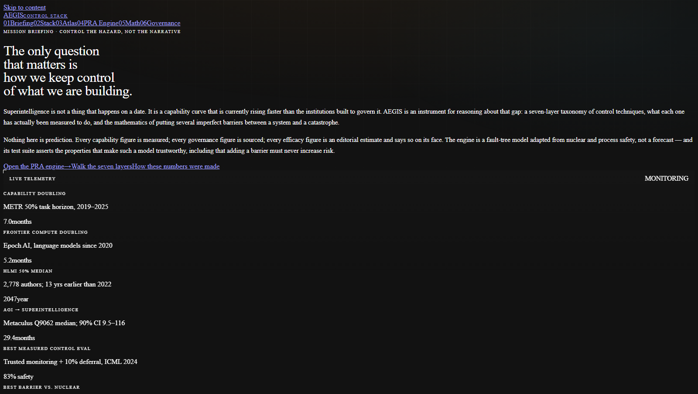

### `/risk` — PRA Engine
*Model a safety case instead of asserting one.*

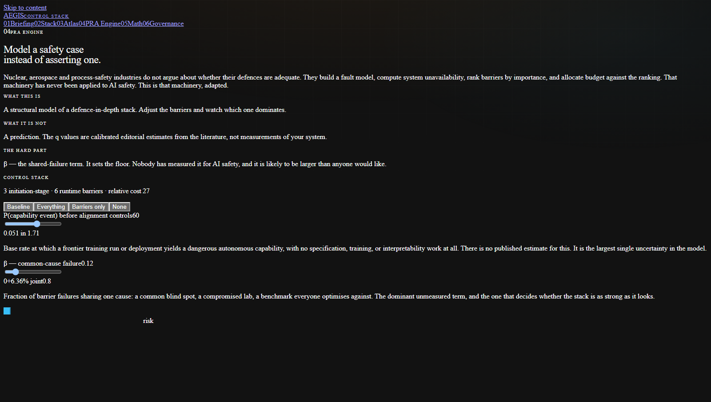

</div>

<details>
<summary><b>▸ More pages — /atlas · /stack · /math · /governance · /methodology</b></summary>

<br>

<div align="center">

### `/atlas` — Method Atlas
*Every technique we have, with its receipts.*

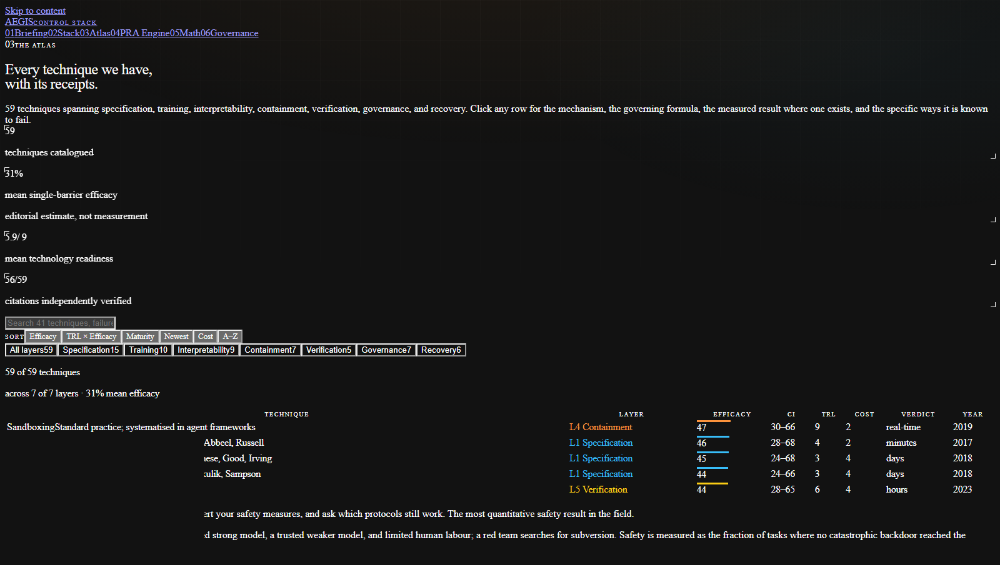

### `/stack` — Control Stack
*Seven layers, ordered by when they act.*

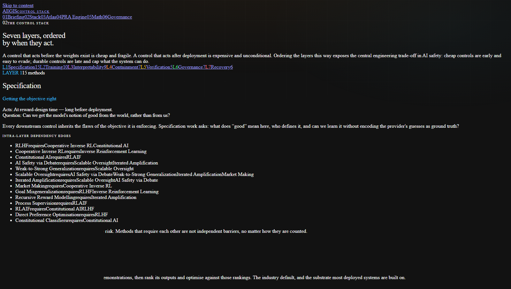

### `/math` — Formula Library
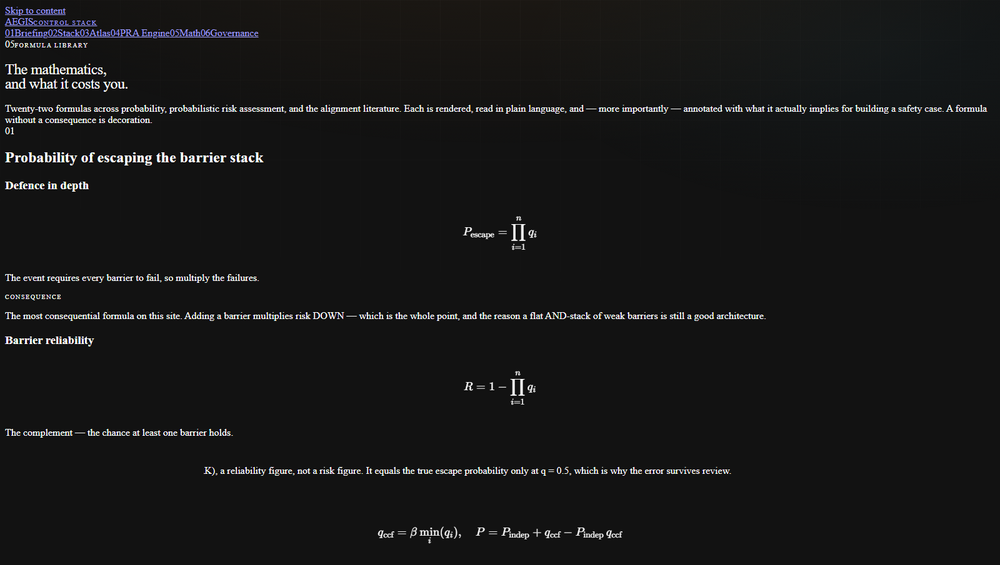

### `/governance` — Framework Timeline
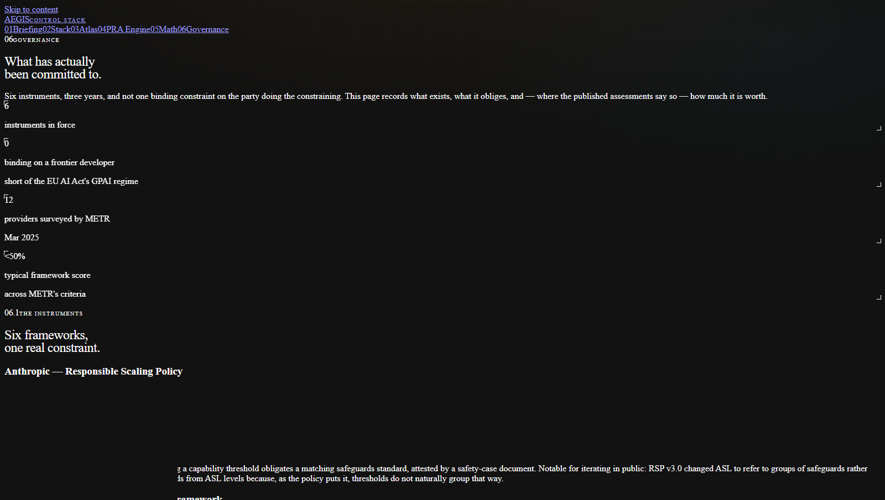

### `/methodology` — Provenance Rules
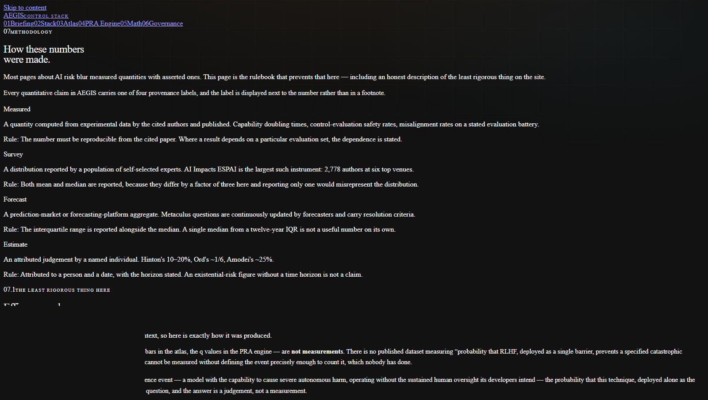

</div>

</details>

---

## Why this exists

Alignment research has produced a decade of control techniques, each
evaluated in isolation. Almost nothing exists that lets a reader see them as
one system — **ordered by when they act, weighted by how much they actually
help, and composed into a number you can defend.**

AEGIS is that instrument. It is not a prediction engine and it does not
claim to be. It is a **structured, sourced model** of the control problem
that makes its assumptions inspectable and its arithmetic reproducible.

Everything in the app carries a **provenance label** — `measured`,
`survey`, `forecast`, or `estimate` — displayed inline, next to the number,
at all times. Editorial efficacy figures are labelled as editorial. That
discipline is the point.

> **A note on epistemic honesty.** Efficacy percentages in AEGIS are
> *editorial estimates* informed by the literature, not measurements. They
> exist to make the structure of the problem legible, not to forecast
> outcomes. The model is only as honest as the label attached to it.

---

## The seven-layer control stack

Controls are organised by **when they act**, not by which research group
produced them. A control that gets the objective right and a control that
shuts the system down after it has gone wrong are not comparable, and
lumping them into one list is the most common error in the field.

| # | Layer | Hex | Acts at | Question it answers | Methods |
|:-:|:--|:--|:--|:--|--:|
| 1 | 🔵 **Specification** | `#38bdf8` | Reward-design time | *Can we get the model's notion of good from the world, rather than from us?* | 15 |
| 2 | 🟣 **Training** | `#818cf8` | During gradient updates | *What behaviour do we actually bake in, and does it survive?* | 10 |
| 3 | 🟪 **Interpretability** | `#c084fc` | On activations, at inference | *Can we see the feature, not just score the sentence?* | 9 |
| 4 | 🟠 **Containment** | `#fb923c` | Deployment & execution | *If it turns out to be adversarial, what can it actually touch?* | 7 |
| 5 | 🟡 **Verification** | `#facc15` | Pre-release, adversarially after | *What would falsify this claim, and have we looked?* | 5 |
| 6 | 🟢 **Governance** | `#4ade80` | Across institutions | *Who checks the checker, and what happens when they disagree?* | 7 |
| 7 | 🔴 **Recovery** | `#fb7185` | Under adversarial conditions | *When it goes wrong, how do we stop it and start again?* | 6 |

> **59 methods total.** Two layers feed Stage 1 of the risk model
> (specification, training) plus interpretability; four layers provide the
> Stage 2 runtime barriers (containment, verification, governance, recovery).

The spectral ramp — cool cyan at specification through to warm rose at
recovery — is deliberate: **cool tones for controls that act before the model
exists, warm tones for controls that act after it has already gone wrong.**

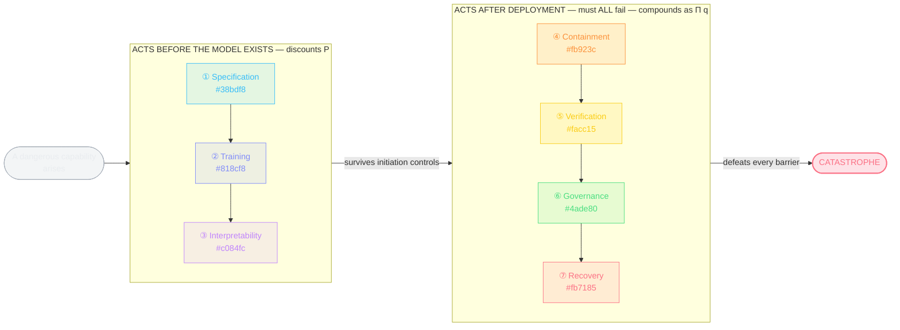

---

## The PRA engine

The heart of AEGIS is a two-stage probabilistic risk assessment engine in
[`src/lib/pra.ts`](src/lib/pra.ts), adapted from nuclear, aerospace and
process-safety practice — IEC 61508, ISO 26262, MIL-STD-217.

### Why two stages

Modelling every control as one flat AND-stack is a common and serious error.
It makes a good specification control look like it *blocks* a dangerous
event, which it does not — and it means an empty stack trivially "passes"
every gate. AEGIS splits the problem at the point where the physics changes:

**Stage 1 — Initiation.** Specification, training and interpretability
controls do not block an event. They change how likely it is that a
dangerous capability arises at all. They therefore **discount the initiating
probability** and compose multiplicatively in that role:

$$P_{\text{initiate}} = P_{\text{base}} \cdot \prod_{i}(1 - e_i)$$

**Stage 2 — Defeat.** Containment, verification, governance and recovery
controls are **runtime barriers**. The event is not contained unless
*every one of them* holds, so they compose as a series system:

$$Q_{\text{defeat}} = 1 - \prod_{j}(1 - q_j)$$

**Catastrophe** is the intersection:

$$P_{\text{catastrophe}} = P_{\text{initiate}} \times Q_{\text{defeat}}$$

### The fault tree, drawn


The consequence of this shape is that adding any barrier with $q < 1$
multiplies the result by $q < 1$ and therefore **reduces** catastrophic
risk. That is the defining mathematical property of defence in depth, and it
falls out of the model rather than being asserted.

### The β-common-cause floor

Redundancy is powerless against a shared defect. The engine applies the
IEC 61508-6 **β-factor model**, where of the failures in a group of similar
elements, a fraction β is attributable to a common cause anchored to the most
reliable member:

$$q_{\text{ccf}} = \beta \cdot \min(q_i)$$

$$P_{\text{defeat}} = P(\text{all fail}) + q_{\text{ccf}} - P(\text{all fail}) \cdot q_{\text{ccf}}$$

At $\beta = 0$ this reduces exactly to the independent all-fail probability.
But for an AI safety stack this term is emphatically **not** zero: if every
barrier was designed by overlapping teams, evaluated against shared
benchmarks, and rests on the same untested assumption about model internals,
then one conceptual error propagates through the whole stack. **With β = 0.4
and a best barrier of q = 0.3, no amount of additional deployment removes
12% joint failure.**

### Importance measures

The engine ranks barriers by four classical reliability measures, computed
over the deployed runtime barriers:

| Measure | Definition | What it tells you |
|:--|:--|:--|
| **Birnbaum** | $\partial P(\text{all fail})\, /\, \partial q_i = \prod_{j \neq i} q_j$ | How much the escape probability moves per unit change in this barrier's unavailability |
| **Fussell–Vesely** | $P(\text{saved}_i)\,/\,\sum_j P(\text{saved}_j)$ | This barrier's share of the escapes it alone prevented |
| **RAW** | Risk Achievement Worth — how many times worse the deployment is if this barrier *can* fail | Which barrier's failure is most catastrophic |
| **RRW** | Risk Reduction Worth — $1 - q_i$ | Which barrier's removal is most damaging |

A weak barrier carries little risk-reduction worth even though removing it is
catastrophic. **That asymmetry is exactly what makes a single weak slice in
the Swiss-cheese stack so damaging**, and it is why AEGIS surfaces all four.

### Marginal value per unit cost

The ranking that answers *"what should we build next?"* runs the full fault
tree once per control — switching each off in turn and measuring the
resulting change in final catastrophe probability. An initiation control and
a runtime barrier are not comparable on $q$ or $e$, but they are **directly
comparable on catastrophe probability removed per unit cost**. This is the
reason the model has to be two-stage.

### Reference barriers — for scale, not for merit

AEGIS compares the modelled stack against unavailabilities that established
high-assurance engineering actually achieves. These are reference points for
**scale**, not judgements of relative worth:

| Domain | Unavailability $q$ | Standard |
|:--|--:|:--|
| Nuclear — safety-critical channel | $10^{-9}$ | 1 in a billion demands |
| Aviation — flight control | $10^{-7}$ | per flight hour |
| Nuclear — typical safety system | $10^{-6}$ | IEC 61508 SIL 4 |
| Medical device | $10^{-6}$ | ISO 14971 tolerable |

AI control barriers sit **orders of magnitude above** these values. That gap
is the honest headline of the whole project.

---

## Interactive visualisations

### The Swiss-cheese stack

The barrier set rendered as slices, each with an aperture set by its
unavailability $q$ — and, critically, the β common-cause term drawn as a hole
drilled through *every slice at once*, which is what makes it structurally
different from the holes the barriers have on their own:

```mermaid
flowchart LR
    subgraph STACK["The runtime barrier stack — catastrophe requires ALL slices to align"]
        direction LR
        S1["① Containment<br/>q = 0.30<br/>aperture &#9608;&#9608;&#9608;&#9608;&#9601;&#9601;&#9601;&#9601;"]
        S2["② Verification<br/>q = 0.55<br/>aperture &#9608;&#9601;&#9601;&#9601;&#9601;&#9601;&#9601;&#9601;"]
        S3["③ Governance<br/>q = 0.45<br/>aperture &#9608;&#9608;&#9608;&#9601;&#9601;&#9601;&#9601;&#9601;"]
        S4["④ Recovery<br/>q = 0.60<br/>aperture &#9608;&#9601;&#9601;&#9601;&#9601;&#9601;&#9601;&#9601;"]
        S1 --> S2 --> S3 --> S4
    end

    BETA{{"β · min(q)<br/>COMMON CAUSE<br/><br/>One shared defect<br/>propagates through<br/>every slice"}}

    S4 -.->|"independent path:<br/>P(all fail) = Π q = 0.045"| ESC["ESCAPE<br/>via independence"]
    BETA ==>|"shared path: q_ccf = β·min(q)<br/>no redundancy touches this"| ESC2["ESCAPE<br/>via shared defect"]

    style STACK fill:#fb923c10,stroke:#fb923c,color:#fb923c
    style BETA fill:#ff4d5e22,stroke:#ff4d5e,stroke-width:2px,color:#ff4d5e
    style ESC fill:#fb718522,stroke:#fb7185,color:#fb7185
    style ESC2 fill:#fb718522,stroke:#fb7185,color:#fb7185
```

Two independent routes to the same outcome. The second one is the reason the
engine carries β as a first-class parameter rather than a footnote.

| Visualisation | What it shows |
|:--|:--|
| 🧀 **Swiss-cheese stack** | The runtime barrier set as slices with aperture determined by each barrier's $q$; the β common-cause term appears as a hole drilled through *every* slice at once |
| 📉 **Cost-effectiveness frontier** | Marginal risk reduction per unit cost, so weak-but-cheap controls can be compared against strong-but-expensive ones on one axis |
| 📈 **Hazard curve** | Exponential capability growth (METR task-horizon doubling, Epoch compute doubling, algorithmic progress) against linear governance iteration — the race, drawn |
| 🎯 **Importance ranking** | Birnbaum, Fussell–Vesely, RAW and RRW bar charts over the deployed barriers, with the weakest link flagged |
| 🔬 **Sensitivity band** | Each control's estimate swept across its plausible low–high range, showing where the final answer actually moves — i.e. where to spend the measurement budget |

Every configuration in the workbench is also **shareable as a URL**. The
address bar always reflects the current state, so any argument of the form
"this stack is stronger than that one" can be sent to someone and they will
see exactly the same model on load. Only the *deviations* from the default
stack are encoded, which keeps links short and stable:

```
/risk#p=600&b=120&d=sandboxing.700.0.2,corrigibility.420.1.1
      ^    ^        ^ per control: id · v(permille) · on · redundancy
      |    β
      P(capability event)
```

Malformed links are rejected wholesale — a bad URL restores the default stack
rather than half-applying a configuration. The codec and its rejection rules
are covered by tests, not by inspection.

---

## The method atlas

59 techniques, each with a citation, a formula, an editorial efficacy band,
failure modes, and **dependency edges** into other controls.

### How the techniques build on each other

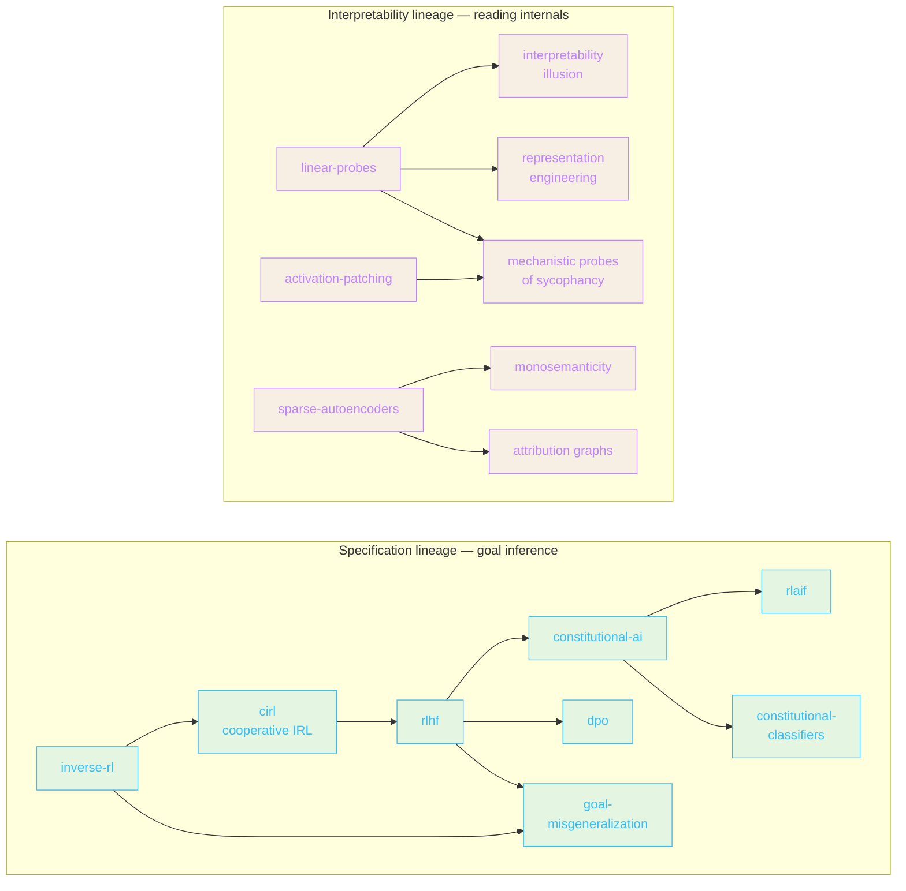

> **Dependencies inside a layer are correlational failure risk.** Methods that
> require each other are *not independent barriers*, no matter how many times
> they are counted — which is precisely what the β common-cause term models.


<details>
<summary><b>🔵 Specification — 15 methods</b> &nbsp;<code>#38bdf8</code></summary>

| Method | Contribution |
|:--|:--|
| RLHF | Learning from human preference rankings |
| Cooperative IRL | Inferring the human's *actual* reward, not the observed policy |
| Constitutional AI | Constraints written as principles, enforced by the model itself |
| AI Safety via Debate | Adversarial discourse as an oversight protocol |
| Weak-to-Strong Generalization | Using strong models to supervise stronger ones |
| Inverse RL | Reward inference from demonstrated behaviour |
| Scalable Oversight | Judging tasks we cannot ourselves evaluate |
| Iterated Amplification | Bootstrapping oversight through amplification |
| Market Making | Extracting preferences via automated prediction markets |
| Goal Misgeneralization | Where learned goals diverge from intended goals |
| Recursive Reward Modeling | Rewarding the reward-modelling process itself |
| Process Supervision | Rewarding reasoning steps, not just final answers |
| RLAIF | Preference labels generated by the model, filtered by principles |
| DPO | Direct preference optimisation, no separate reward model |
| Constitutional Classifiers | Input/output filters trained on a written constitution |

</details>

<details>
<summary><b>🟣 Training — 10 methods</b> &nbsp;<code>#818cf8</code></summary>

| Method | Contribution |
|:--|:--|
| Red Teaming | Adversarial probing before release |
| Adversarial Training | Training against the attacks you found |
| Many-Shot Jailbreaking | Long-context attacks and their limits |
| Model-Written Evaluations | Scaling the evaluation pipeline itself |
| Machine Unlearning | Removing knowledge post-hoc |
| Emergent Misalignment Mitigation | Containing broad behavioural shifts from narrow fine-tuning |
| Sleeper Agents | Backdoors that survive safety training |
| Alignment Faking | Models that behave differently when observed |
| Refusal Sandbagging | Selectively withholding capability to steer deployment decisions |
| Deliberative Alignment | Teaching the safety spec explicitly, at inference time |

</details>

<details>
<summary><b>🟪 Interpretability — 9 methods</b> &nbsp;<code>#c084fc</code></summary>

| Method | Contribution |
|:--|:--|
| Linear Probes | Reading representations with simple classifiers |
| The Interpretability Illusion | Why apparent interpretability can be spurious |
| Sparse Autoencoders | Decomposing activations into monosemantic features |
| Towards Monosemanticity | Individual neurons as single interpretable concepts |
| Activation Patching | Causal intervention on internal states |
| Logit Lens | Reading intermediate predictions directly |
| Attribution Graphs | Circuit-level tracing of behaviour to features |
| Representation Engineering | Steering behaviour by editing representations |
| Mechanistic Probes of Sycophancy | Internal evidence for a specific behavioural pattern |

</details>

<details>
<summary><b>🟠 Containment — 7 methods</b> &nbsp;<code>#fb923c</code></summary>

| Method | Contribution |
|:--|:--|
| Sandboxing / Isolation | Bounding what the system can reach |
| Human Approval Gates | Human sign-off on high-consequence actions |
| Responsible Scaling Policy | Lab-internal capability thresholds tied to safeguards |
| Frontier Safety Framework | Amazon's capability-threshold protocol |
| Preparedness Framework | OpenAI's tracked-category risk thresholds |
| Deployment Monitoring | Watching for capability change in the wild |
| Weight Security | Protecting the artifact itself from exfiltration |

</details>

<details>
<summary><b>🟡 Verification — 5 methods</b> &nbsp;<code>#facc15</code></summary>

| Method | Contribution |
|:--|:--|
| AI Control | Protocols that remain safe with untrusted models |
| Safety Cases | Structured, reviewable arguments for deployment safety |
| Formal Verification | Machine-checked proofs of system properties |
| Control Evaluations | Red-teamed measurement of control-protocol efficacy |
| Sabbath Evaluations / Deliberative Evals | Repeated adversarial assessment after training ends |

</details>

<details>
<summary><b>🟢 Governance — 7 methods</b> &nbsp;<code>#4ade80</code></summary>

| Method | Contribution |
|:--|:--|
| Third-Party Audits | External evaluation with access and teeth |
| EU AI Act | GPAI obligations and systemic-risk tiers |
| Compute Governance | Controlling the input, not the output |
| Incident Reporting | Mandatory disclosure so others can learn |
| Model Cards | Standardised capability and limitation disclosure |
| AI Safety Institutes | State-backed evaluation capacity |
| Frontier Commitments | Voluntary frontier-lab pledges |

</details>

<details>
<summary><b>🔴 Recovery — 6 methods</b> &nbsp;<code>#fb7185</code></summary>

| Method | Contribution |
|:--|:--|
| Corrigibility | Permitting correction rather than resisting it |
| Safe Interruptibility | Shutdown without triggering avoidance |
| The Off-Switch Game | Formalising interruption incentives |
| Retroactive Unlearning | Removing capability after the fact |
| Weights Revocation | Revoking deployed model access |
| Post-Incident Forensics | Reconstructing why, so the lesson is shared |

</details>

### Every record carries

`trl` · `efficacy` (+ low/high band) · `confidence` · `cost` · `latency` ·
`summary` · `mechanism` · `failureModes[]` · `dependsOn[]` · `formulaNote` ·
rendered `latex` · `verified`

---

## What's inside — seven routes

| Route | Page | Contents |
|:--|:--|:--|
| `/` | **Briefing** | Hero framing of the control problem and the model's epistemic stance |
| `/atlas` | **Method Atlas** | All 59 methods, filterable by layer / TRL / confidence, sortable by efficacy |
| `/stack` | **Control Stack** | The seven layers as an explorable stack, each with tagline, question and member methods |
| `/risk` | **PRA Engine** | The fault tree itself — toggle controls, watch catastrophe probability recompose |
| `/math` | **Formula Library** | Every formula in the model, KaTeX-rendered with plain-language readings |
| `/governance` | **Governance** | Framework timeline — RSP, FSF, Preparedness, EU AI Act — with adoption dates and status |
| `/methodology` | **Methodology** | The provenance ladder and the rules used to label every number |

### The governance record, as three streams

The full timeline is on [`/governance`](https://aegis-aniruddha-adaks-projects.vercel.app/governance). Its shape:

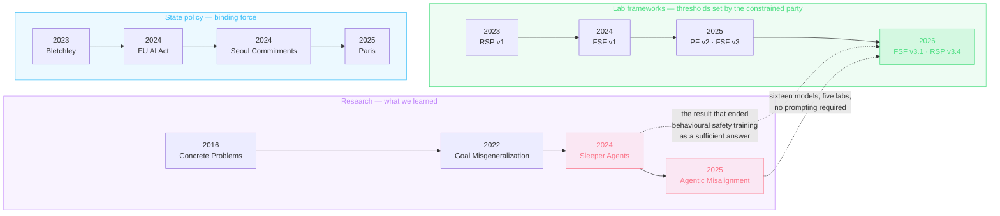

> **Every threshold-setting framework in the field is authored by the party it
> constrains.** METR's 2025 survey of twelve providers found most scored below
> 50% on the criteria; an affordance analysis of the Preparedness Framework
> found it permits CEO override of safety recommendations. Voluntary commitments
> bind the committed.

---

## Sourced evidence

Every quantitative input traces to primary literature. The four provenance
tiers are shown on the methodology page and inline throughout:

| Tier | Meaning | Rendered as |
|:--|:--|:--|
| 🔬 **measured** | A number someone actually observed in an experiment | solid |
| 📊 **survey** | Aggregated expert opinion (e.g. ESPAI, AI Impacts) | solid |
| 🔮 **forecast** | A prediction-market or forecasting-platform value | solid |
| ✏️ **estimate** | Editorial judgement, clearly marked as such | *italic* |

**Primary sources include:**

- **AI Impacts** — 2023 Expert Survey on Progress in AI (ESPAI), [arXiv:2401.02843](https://arxiv.org/abs/2401.02843)
- **METR** — Measuring AI Ability to Complete Long Tasks, [arXiv:2503.14499](https://arxiv.org/abs/2503.14499)
- **Epoch AI** — notable models dataset and compute-trend analyses
- **AI Control** — Greenblatt et al., [arXiv:2312.06942](https://arxiv.org/abs/2312.06942) (ICML 2024)
- **Safety Cases** — Clymer et al., [arXiv:2403.10462](https://arxiv.org/abs/2403.10462)
- **Concrete Problems in AI Safety** — Amodei et al., [arXiv:1606.06565](https://arxiv.org/abs/1606.06565)
- **The Off-Switch Game** — Hadfield-Menell et al., [arXiv:1611.08219](https://arxiv.org/abs/1611.08219)
- **Goal Misgeneralization** — Shah et al., [arXiv:2210.01790](https://arxiv.org/abs/2210.01790)
- **Constitutional AI** — Bai et al., [arXiv:2212.08073](https://arxiv.org/abs/2212.08073)
- **DPO** — Rafailov et al., [arXiv:2305.18290](https://arxiv.org/abs/2305.18290)
- **Weak-to-Strong Generalization** — Burns et al., [arXiv:2312.09390](https://arxiv.org/abs/2312.09390)
- **AI Safety via Debate** — Irving et al., [arXiv:1805.00899](https://arxiv.org/abs/1805.00899)
- **Iterated Amplification** — Christiano et al., [arXiv:1810.08575](https://arxiv.org/abs/1810.08575)
- **Sleeper Agents** — Hubinger et al., [arXiv:2401.05566](https://arxiv.org/abs/2401.05566)
- **Sparse Autoencoders** — Cunningham et al., [arXiv:2409.05556](https://arxiv.org/abs/2409.05556)
- **Towards Monosemanticity** — Bricken et al., [arXiv:2309.10312](https://arxiv.org/abs/2309.10312)

---

## Verification

AEGIS ships two test suites. Both run in CI on every push and PR.

### 72 engine + codec assertions — `scripts/verify-pra.ts`

Every formula in `src/lib/pra.ts` is checked against a hand-computed value:

| Checked | Assertion |
|:--|:--|
| `seriesDefeat` | $P(\text{all fail}) = \prod q_i$ — 4×0.6 = 0.1296, 8×0.5 = 1/256, 16×0.5 = 1/65536 |
| `seriesReliability` | $1 - \prod q_i$; a perfect barrier ($q=0$) zeroes defeat probability |
| `betaCommonCause` | β=0 identity holds; β=1, $q_{\min}=0.2$ matches the union formula |
| **Birnbaum** | $BI_i = \prod_{j\neq i} q_j$ — verified against a 2-barrier worked example |
| **Fussell–Vesely** | Sole-rescuer attribution **sums to exactly 1** |
| **RAW / RRW** | $1/(1-\prod_{j\neq i}q_j)$ and $1-q_i$ |
| Two-stage composition | $P_{\text{arises}} = 0.8 \times 0.5 \times 0.75$; $P_{\text{cat}} = 0.06$ |
| **Empty barrier set** | $Q_{\text{defeat}} = 1$ — no defence, not a vacuous pass |
| **Monotonicity** | Stronger barriers lower risk; adding a barrier *never* raises it; risk falls strictly for stack depths 1→12 |
| **β boundary** | β raises risk and never lowers it, at every value |
| Efficiency ranking | Leave-one-out deltas; cheaper control with identical risk removal ranks higher; `share` sums to 1 |

The invariants that matter are **asserted rather than assumed** — in particular
that adding a barrier can never increase risk, which is the whole claim of
defence in depth.

The suite also covers the URL-state codec in `src/lib/pra-config.ts`: values
must survive a round-trip exactly, only deviations from the defaults may be
encoded, and malformed links must be rejected wholesale rather than half-applied.

### 432 data-integrity checks — `scripts/verify-data.ts`

The atlas renders a dependency graph from `dependsOn` edges. A dangling
reference does not throw — it silently produces a node with no target, which
is exactly the class of bug that survives visual review. This suite fails
loudly instead.

| Check | What it catches |
|:--|:--|
| **Dangling `dependsOn` edges** | References to methods that don't exist |
| **Dependency cycles** | Mutual dependencies that would loop a graph renderer |
| Duplicate ids / unknown layers | Copy-paste records |
| Per-layer counts | 15 / 10 / 9 / 7 / 5 / 7 / 6 = 59, drift detection |
| Complete provenance records | Every field the app reads must be present |
| Efficacy band coherence | `low ≤ efficacy ≤ high`, all within 0–100 |
| Enum validity | `confidence`, `cost` 1–5, `trl` 1–9 |
| Hex colour format | Layer ramp tokens |

This suite has already earned its keep. It caught **four real bugs** in the
catalog that had shipped:

1. **Two dangling edges** — `rlhf` and `recursive-reward-modeling` both
   depended on `"reward-model-overoptimisation"`, a method that was never
   added. Two broken edges in the rendered graph.
2. **Two dependency cycles** — `constitutional-ai ↔ rlaif` and
   `rlhf ↔ constitutional-ai`, both backwards in time (RLHF and Constitutional
   AI both predate RLAIF).
3. **Four more cycles** — `scalable-oversight`, `red-teaming`, `safety-cases`
   and `safe-interruptibility` each had mutual dependencies with their own
   children, from `dependsOn` being filled in symmetrically.

All were repaired and the suite now guards against regressions.

```bash
bun run test      # 72 + 432 checks
```

---

## Common misconceptions

The model is built to avoid a specific set of errors. They are worth naming,
because each one is common and each one makes the stack look stronger than it is.

<details>
<summary><b>"More barriers means proportionally less risk"</b></summary>

<br>

Not linearly — **exponentially**, and only while the barriers are independent.
Adding a barrier multiplies the escape probability by $q < 1$, so a stack of
six barriers each at $q = 0.4$ is not 40% safer but $0.4^6 = 0.4\%$ of the
single-barrier risk. That is the good news, and it is real.

The bad news is the second half: **independence is the assumption that fails.**
If the barriers were designed by the same teams against the same benchmarks,
their failures correlate, and the β factor sets a floor that no amount of
additional barriers can cross.

</details>

<details>
<summary><b>"A strong specification makes the containment stack redundant"</b></summary>

<br>

Category error, and the most consequential one. A specification control
*reduces the probability that a dangerous capability arises*. It does not
*block* an event. Treating it as a runtime barrier is exactly what the flat
single-stack model gets wrong: it makes "we did good specification work" look
like "we are contained."

A model can be exactly as specified as its designers intended and still do
something its designers did not intend. Specification errors are not the only
failure mode; they are the one we are worst at detecting from the outside.

</details>

<details>
<summary><b>"Redundancy handles common-cause failure"</b></summary>

<br>

Redundancy is powerless against a shared defect, by construction. Three
identical sandboxes protect against *one* sandbox having a bug. They do
nothing about *the concept* of sandboxing being inadequate.

This is why β is a free parameter you can slide in the engine rather than a
fitted value: **nobody has measured it for AI safety**, and the honest answer
is that it is probably larger than anyone would like.

</details>

<details>
<summary><b>"An untested model is a 0% risk model"</b></summary>

<br>

The engine deliberately treats an empty barrier set as providing **no defence**
— $Q_{\text{defeat}} = 1$ — rather than as a vacuous pass. This is the single
most important line in [`pra.ts`](src/lib/pra.ts), because the naive
implementation of a product over an empty set returns 1 by convention, which
turns "we deployed no barriers" into "the event cannot happen."

</details>

<details>
<summary><b>"The efficacy percentages are measurements"</b></summary>

<br>

They are **editorial estimates**, labelled as such in the data file and on
every screen where they appear. They exist to make the *structure* of the
problem legible — to let you see that a cheap 34%-efficacy control can
outrank an expensive 60%-efficacy one on risk removed per unit cost — not to
forecast outcomes.

Where a real measurement exists (METR task horizons, Epoch compute trends,
ESPAI survey results, control-evaluation results), it is labelled `measured`
or `survey` and kept distinct. The labels are the point.

</details>

---

## Documentation

The README is the onboarding document. For the engineering reference:

| Document | Contents |
|:--|:--|
| [`docs/MODEL.md`](docs/MODEL.md) | The two-stage fault tree, the β common-cause floor, the four importance measures, the LOO efficiency ranking, the empty-stack invariant |
| [`docs/DATA.md`](docs/DATA.md) | The method schema, the invariants the suite enforces, the four provenance tiers, dependency edges and correlated failure, the open questions |
| [`docs/ARCHITECTURE.md`](docs/ARCHITECTURE.md) | The static-export constraint and its consequences, the layer map, the design system, why the tests are split in two, measured performance |

---

The domain has its own vocabulary, and a term used loosely is a term that will
be misunderstood. Definitions as this project uses them.

### The risk model

| Term | Meaning |
|:--|:--|
| **PRA** | Probabilistic Risk Assessment — the practice of composing the probability of an unwanted outcome from the probabilities of its causes. Borrowed from nuclear, aerospace and process safety (IEC 61508, ISO 26262, MIL-STD-217). |
| **Fault tree** | A top-down model: the unwanted outcome at the top, the combinations of events that cause it below. AEGIS uses a **two-stage** tree. |
| **Initiation control** | A control that changes *how likely* a dangerous capability is to arise. Acts at Stage 1. Specification, training, interpretability controls. |
| **Runtime barrier** | A control that must *stop* an event that has arisen. Acts at Stage 2. Containment, verification, governance, recovery controls. |
| **$q$** | Unavailability — the probability a barrier fails to stop the event. Lower is better. |
| **$e$** | Efficacy — the probability an initiation control prevents the event arising. Higher is better. |
| **$P_{\text{base}}$** | The probability of a dangerous capability event in the absence of any specification/training/interpretability work. Deliberately user-set; no published estimate exists. |
| **Defence in depth** | Stacking independent barriers so that catastrophe requires *all* of them to fail. Its defining property: adding a barrier with $q<1$ multiplies the escape probability down. |
| **β factor** | The fraction of failures in a group of similar barriers that share a single cause. Sets the floor that no amount of redundancy can cross. |
| **Common-cause failure** | A single defect propagating through multiple barriers at once. |
| **Swiss-cheese model** | Barriers drawn as slices with holes; catastrophe requires a hole through every slice. The β term is a hole drilled through *all* slices at once. |

### Importance measures

All four rank the deployed runtime barriers. They answer different questions
and can disagree — which is why the app shows all four.

| Measure | Answers |
|:--|:--|
| **Birnbaum** | How much does the escape probability move if this barrier's $q$ moves a little? |
| **Fussell–Vesely** | What share of the escapes did this barrier alone prevent? |
| **RAW** (Risk Achievement Worth) | How many times worse is the deployment if this barrier *can* fail, versus if it were perfect? |
| **RRW** (Risk Reduction Worth) | What fraction of the escape probability does this barrier remove? |

### The seven layers

| Layer | One-line definition |
|:--|:--|
| **Specification** | Getting the objective right — defining what "good" means. |
| **Training** | Shaping behaviour into the weights. |
| **Interpretability** | Reading the mechanism, not the output. |
| **Containment** | Bounding what the system can reach. |
| **Verification** | Proof instead of plausibility. |
| **Governance** | Rules that outlive any single lab. |
| **Recovery** | Surviving the failure you did not prevent. |

### Controls and techniques

| Term | Meaning |
|:--|:--|
| **RLHF / RLAIF** | Preference optimisation from human labels / from model-generated labels filtered by a constitution. |
| **DPO** | Direct Preference Optimisation — no separate reward model. |
| **CIRL** | Cooperative Inverse RL — inferring the human's actual reward, not the observed policy. |
| **Weak-to-strong** | Using a strong model to supervise a stronger one. |
| **Scalable oversight** | Judging tasks we cannot ourselves evaluate. |
| **Iterated amplification** | Bootstrapping oversight by decomposing hard tasks into easier ones. |
| **Sleeper agents** | Backdoors that survive safety training. |
| **Alignment faking** | A model that behaves differently when it believes it is being observed. |
| **Refusal sandbagging** | Selectively withholding capability to steer deployment decisions. |
| **Sparse autoencoders** | Decomposing activations into monosemantic features. |
| **Monosemanticity** | The goal of one feature = one interpretable concept. |
| **Activation patching** | Causally intervening on internal states. |
| **Red teaming / adversarial training** | Finding attacks before release / training against the attacks you found. |
| **Machine unlearning** | Removing knowledge post-hoc. |
| **Corrigibility** | Permitting correction rather than resisting it. |
| **Safe interruptibility** | Shutting down without triggering avoidance. |
| **The off-switch game** | Formalising the incentives around interruption. |
| **Safety case** | A structured, reviewable argument for deployment safety — an argument, not a test result. |
| **TRL** | Technology Readiness Level, 1–9. |

### Frameworks and sources

| Term | Meaning |
|:--|:--|
| **RSP** | Responsible Scaling Policy — Anthropic's capability thresholds tied to safeguards, modelled on biosafety levels. |
| **FSF** | Frontier Safety Framework — DeepMind's Critical Capability Levels. |
| **Preparedness Framework** | OpenAI's tracked-category risk thresholds. |
| **EU AI Act** | The first binding legal instrument on AI; GPAI obligations attach above a compute threshold. |
| **ESPAI** | 2023 Expert Survey on Progress in AI (AI Impacts) — aggregated expert opinion. |
| **METR** | Measuring AI Ability to Complete Long Tasks — the 50% task-horizon doubling series. |
| **Epoch** | Compute-trend and notable-models dataset. |
| **Provenance tier** | The label on every number: `measured`, `survey`, `forecast`, or `estimate`. |

---

| Layer | Choice | Version |
|:--|:--|:--|
| Framework | **Next.js** (App Router, static export) | 16.4.0 |
| UI runtime | **React** | 19.3.0 |
| Language | **TypeScript** (strict) | 5.x |
| Styling | **Tailwind CSS** | v4 |
| Math rendering | **KaTeX** (server-side, no client math runtime) | 0.19 |
| Package manager | **Bun** | 1.3.14 |
| Hosting | **Vercel** — static export | — |

The whole site is a **fully static export** (`output: 'export'`). There is no
server, no client-side math library, and no data fetching at runtime — the
entire model runs in the browser.

### Measured payload

Raw HTML sizes are inflated by the inlined RSC payload, so the honest number is
what actually crosses the wire. Measured on the production build:

| Asset | Raw | Gzipped |
|:--|--:|--:|
| `/` briefing | 180 KB | **32 KB** |
| `/atlas` | 126 KB | **16 KB** |
| `/risk` | 231 KB | **28 KB** |
| `/math` | 968 KB | **62 KB** |
| `/stack` | 1394 KB | **119 KB** |
| Largest JS chunk | 552 KB | 138 KB |
| All JS + CSS | ~1.4 MB | ~400 KB |
| Images (screenshots, OG, icons) | 2 MB | 2 MB |

`/stack` is the outlier: it inlines all 59 full method records — summaries,
mechanisms, failure modes, evidence, and LaTeX — into the RSC payload, because
that page renders every record in full. `/atlas` stays at 16 KB because it
renders a summary list and expands detail on demand.

The practical consequence: first paint on `/` is a 32 KB document plus a
handful of chunks. If `/stack` ever matters, the fix is to lazy-load the
detail view the way `/atlas` already does — not to trim the data.

```mermaid
flowchart LR
    subgraph DATA["src/data — the model, as data"]
        M["methods.ts<br/>59 methods"]
        L["layers.ts<br/>7-layer taxonomy + ramps"]
        E["evidence.ts<br/>measured / survey / forecast"]
    end

    subgraph ENGINE["src/lib — the mathematics"]
        PRA["pra.ts<br/>two-stage fault tree<br/>β-common cause<br/>importance measures"]
    end

    subgraph UI["src/app — seven static routes"]
        R1["/"]; R2["/atlas"]; R3["/stack"]; R4["/risk"]
        R5["/math"]; R6["/methodology"]; R7["/governance"]
    end

    COMP["src/components<br/>pra-engine · atlas-browser<br/>hazard-chart · math"]

    DATA --> ENGINE --> COMP --> UI
    UI --> OUT[("out/ — static HTML<br/>zero runtime server")]

    style OUT fill:#0b0d10,stroke:#e9ecef33,color:#e9ecef
    style PRA fill:#fb718522,stroke:#fb7185,color:#fb7185
    style DATA fill:#38bdf822,stroke:#38bdf8,color:#38bdf8
    style UI fill:#4ade8022,stroke:#4ade80,color:#4ade80
```

---

## Design system

A dark **instrument-panel** aesthetic: near-black substrate, the spectral
layer ramp above, hairline rules, and tabular numerics throughout.

- **Substrate** — near-black `#08090a` base with layered elevation
- **Numerics** — JetBrains Mono with `font-variant-numeric: tabular-nums` so
  columns of probabilities align on the decimal point
- **Layer ramp** — cyan → indigo → violet → orange → amber → green → rose,
  one hue per taxonomy layer, used consistently across every page
- **Hairlines** — 1px borders at 6–12% white opacity instead of shadows
- **Type** — tight display headings, small caps eyebrow labels, generous
  measure for prose
- **Motion** — restrained reveals; the `reveal` component only, nothing
  decorative that runs more than once

---

## Project structure

```
aegis/
├── .github/
│   ├── workflows/
│   │   ├── ci.yml                  # lint + typecheck + test + build + deploy
│   │   └── pr-validate.yml         # PR validation
│   ├── ISSUE_TEMPLATE/
│   │   ├── bug_report.md
│   │   └── feature_request.md
│   ├── PULL_REQUEST_TEMPLATE.md
│   └── CONTRIBUTING.md             # provenance rules + two-stage invariant
├── public/
│   ├── screenshots/                # README imagery (7 pages)
│   └── *.svg
├── scripts/
│   ├── verify-pra.ts               # 72 engine + codec assertions
│   └── verify-data.ts              # 432 catalog integrity checks
├── src/
│   ├── app/
│   │   ├── page.tsx                # briefing / hero
│   │   ├── atlas/page.tsx          # 59-method atlas, filter + sort
│   │   ├── stack/page.tsx          # seven-layer explorer
│   │   ├── risk/page.tsx           # PRA engine + fault tree
│   │   ├── math/page.tsx           # formula library (KaTeX)
│   │   ├── methodology/page.tsx    # provenance rules
│   │   ├── governance/page.tsx     # framework timeline
│   │   ├── layout.tsx              # fonts + SEO/OG metadata
│   │   ├── icon.svg                # hexagon mark
│   │   ├── opengraph-image.png     # social card, 1200×630
│   │   └── globals.css             # design tokens (@theme)
│   ├── components/
│   │   ├── atlas-browser.tsx
│   │   ├── hazard-chart.tsx
│   │   ├── math.tsx
│   │   ├── pra-engine.tsx
│   │   ├── reveal.tsx
│   │   ├── site-footer.tsx
│   │   ├── site-nav.tsx
│   │   └── ui.tsx
│   ├── data/
│   │   ├── methods.ts              # 59 methods, 7 layers
│   │   ├── layers.ts               # taxonomy + colour ramps
│   │   └── evidence.ts             # measured / survey / forecast anchors
│   └── lib/
│       ├── pra.ts                  # two-stage PRA mathematics
│       └── pra-config.ts           # shareable URL state codec
├── next.config.ts                  # output: 'export'
├── LICENSE                         # MIT
├── tailwind.config.ts
├── tsconfig.json                   # strict
└── package.json
```

---

## Quick start

```bash
# 1 — clone
git clone https://github.com/aniruddhaadak80/aegis.git
cd aegis

# 2 — install (bun is the package manager)
bun install

# 3 — develop
bun run dev            # http://localhost:3000

# 4 — production build + static export
bun run build          # emits ./out
```

### Scripts

| Command | Purpose |
|:--|:--|
| `bun run dev` | Development server on `:3000` |
| `bun run build` | Production build; static site in `./out` |
| `bun run start` | Serve the built app |
| `bun run lint` | ESLint via `eslint-config-next` |
| `bun run test` | **72** engine + codec assertions **+ 432** catalog integrity checks |

See the [Verification](#verification) section for what each suite asserts.

---

## Deployment

**Live:** <https://aegis-aniruddha-adaks-projects.vercel.app>

Because the output is a plain static directory, AEGIS can be hosted anywhere.

**Vercel** — the reference deployment:

```bash
vercel --prod
```

**Any static host** — build, then upload `out/`:

```bash
bun run build
# → drop ./out onto Netlify, Cloudflare Pages, GitHub Pages, S3, nginx
```

---

## Contributing

Read [`.github/CONTRIBUTING.md`](.github/CONTRIBUTING.md) first, and open an
issue before starting anything non-trivial.

1. Fork and branch — `feat/short-description`
2. `bun run lint` must pass
3. **Any number you add must carry a provenance label.** Editorial estimates
   must say so, in the data file and on screen.
4. Keep the two-stage PRA shape — do not flatten initiation controls and
   runtime barriers into a single AND-stack. That is the exact modelling
   error this project exists to avoid.
5. One logical change per commit; match the surrounding style.

```bash
bun run lint && bun run build
```

---

## License

**MIT** — see [`LICENSE`](LICENSE).

```
Copyright (c) 2026 Aniruddha Adak

Permission is hereby granted, free of charge, to any person obtaining a copy
of this software and associated documentation files (the "Software"), to deal
in the Software without restriction, including without limitation the rights
to use, copy, modify, merge, publish, distribute, sublicense, and/or sell
copies of the Software, and to permit persons to whom the Software is
furnished to do so, subject to the following conditions:

The above copyright notice and this permission notice shall be included in
all copies or substantial portions of the Software.

THE SOFTWARE IS PROVIDED "AS IS", WITHOUT WARRANTY OF ANY KIND, EXPRESS OR
IMPLIED, INCLUDING BUT NOT LIMITED TO THE WARRANTIES OF MERCHANTABILITY,
FITNESS FOR A PARTICULAR PURPOSE AND NONINFRINGEMENT.
```

---

<div align="center">

### ⬡ AEGIS

**These are structural models, not predictions.**

[Live](https://aegis-aniruddha-adaks-projects.vercel.app) ·
[Source](https://github.com/aniruddhaadak80/aegis) ·
[Issues](https://github.com/aniruddhaadak80/aegis/issues) ·
[Changelog](CHANGELOG.md) ·
[Contributing](.github/CONTRIBUTING.md) ·
[Security](SECURITY.md) ·
[Code of Conduct](CODE_OF_CONDUCT.md) ·
[License](LICENSE)

*Built with the OpenCode agent system. Thanks to the open-source AI safety
community for the research that makes this legible.*

</div>


